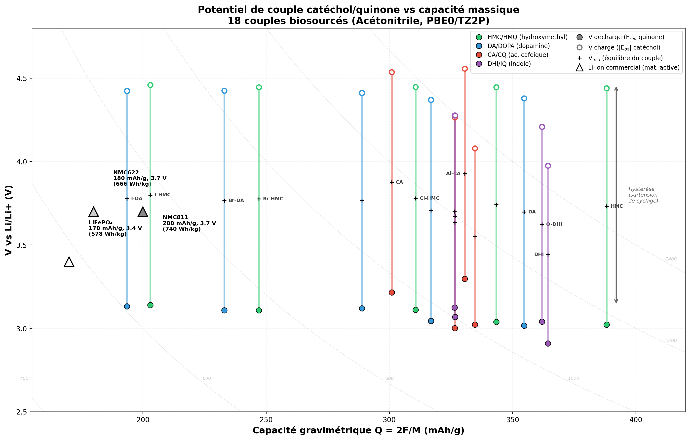

# Biosources et Classement des 73 Molecules

Ce document recense les sources naturelles/biosources des 73 molecules etudiees,
puis propose un classement de priorite pour la synthese basee sur 3 criteres :
abondance, potentiel redox, et capacite gravimetrique.

---

## 1. Bloc Catechols (19 molecules)

### 1.1 Famille HMC (hydroxymethylcatechol)

| Molecule | M (g/mol) | Source naturelle | Etapes |
|----------|-----------|-----------------|--------|
| HMC1,51 | 140.14 | Reduction du protocatechualdehyde (*Salvia miltiorrhiza*, *Gastrodia elata*) | 0-1 |
| F-HMC2 | 158.13 | Semi-synthetique : fluorination electrophile de HMC (Selectfluor) | 1-2 |
| Cl-HMC3 | 174.58 | Semi-synthetique : chloration electrophile de HMC (NCS) | 1 |
| Br-HMC3 | 219.03 | Semi-synthetique : bromation electrophile de HMC (NBS) | 1 |
| I-HMC3 | 266.03 | Semi-synthetique : iodation electrophile de HMC (I2/KI) | 1 |

### 1.2 Famille DA (dopamine)

| Molecule | M (g/mol) | Source naturelle | Etapes |
|----------|-----------|-----------------|--------|
| DA4,51 | 153.18 | Neurotransmetteur endogene ; banane (*Musa* spp.), *Mucuna pruriens* | 0 |
| F-DA5 | 171.17 | Synthetique : fluorination non triviale (Balz-Schiemann ou Selectfluor) | 2 |
| Cl-DA6,51 | 187.63 | Synthetique : chloration electrophile de DA (NCS/SO2Cl2) | 1 |
| Br-DA7 | 232.08 | Synthetique : bromation electrophile de DA (NBS) | 1 |
| I-DA8 | 279.08 | Synthetique : iodation electrophile de DA (I2/KI) | 1 |
| L-DA9,51 | 197.19 | *Mucuna pruriens* (3-6% poids sec graines), *Vicia faba* | 0 |

### 1.3 Famille CA (acide cafeique)

| Molecule | M (g/mol) | Source naturelle | Etapes |
|----------|-----------|-----------------|--------|
| CA10,51 | 180.16 | Ubiquitaire : cafe, fruits, cereales (acide chlorogenique) | 0 |
| Al-CA11 | 164.16 | Intermediaire monolignol (voie phenylpropanoide) | 0 |
| HO-CA12,13 | 166.18 | Monolignol C-lignine : vanille, ricin (*Ricinus communis*) | 0 |
| H2C-CA | 162.19 | Semi-synthetique : Wittig sur caffealdehyde (1 etape) | 1-2 |

### 1.4 Famille DHI (5,6-dihydroxyindole)

| Molecule | M (g/mol) | Source naturelle | Etapes |
|----------|-----------|-----------------|--------|
| DHI14,51 | 149.15 | Intermediaire eumelanine (voie Raper-Mason), encre de seiche | 0 |
| O-DHI15 | 150.13 | Bio-inspire : benzofuranes dans la lignine et les plantes | ~1 |
| S-DHI16 | 166.20 | Bio-inspire pheomelanine : heterocycles S-catechol | ~2 |
| P-DHI17 | 166.12 | Purement synthetique (sonde theorique effet heteroatome) | >2 |

---

## 2. Bloc Quinones (19 molecules)

Les quinones sont les formes oxydees (2 electrons) des catechols correspondants.
Leur biosource est identique a celle du catechol parent -- l'oxydation est la
reaction redox etudiee.

| Quinone | Catechol parent | M (g/mol) |
|---------|----------------|-----------|
| HMQ1,51 | HMC | 138.12 |
| F-HMQ2 | F-HMC | 156.11 |
| Cl-HMQ3 | Cl-HMC | 172.57 |
| Br-HMQ3 | Br-HMC | 217.02 |
| I-HMQ3 | I-HMC | 264.02 |
| DOPA4,51 | DA | 151.16 |
| F-DOPA5 | F-DA | 169.15 |
| Cl-DOPA6,51 | Cl-DA | 185.61 |
| Br-DOPA7 | Br-DA | 230.06 |
| I-DOPA8 | I-DA | 277.06 |
| L-DOPA9,51 | L-DA | 195.17 |
| CQ10,51 | CA | 178.14 |
| Al-CQ11 | Al-CA | 162.14 |
| HO-CQ12,13 | HO-CA | 164.16 |
| H2C-CQ | H2C-CA | 160.17 |
| IQ14,51 | DHI | 147.13 |
| O-IQ15 | O-DHI | 148.12 |
| S-IQ16 | S-DHI | 164.19 |
| P-IQ17 | P-DHI | 164.10 |

---

## 3. Bloc Lignine-derived / Phenylpropanoides (35 molecules)

### 3.1 Catechols simples

| Molecule | M (g/mol) | Source naturelle | Etapes |
|----------|-----------|-----------------|--------|
| CATECHOL18 | 110.11 | Bio-huile de pyrolyse de lignine ; O-demethylation guaiacol | 0-1 |
| 4-METHYLCATECHOL19 | 124.14 | Pyroligneous acid ; O-demethylation du creosol | 0-1 |
| 4-ETHYLCATECHOL20 | 138.17 | Pyroligneous acid ; vin (*Brettanomyces* depuis acide cafeique) | 0 |
| 4-PROPYLCATECHOL21 | 152.19 | Hydrogenolyse C-lignine (ricin, vanille) | 1 |
| 4-ALLYLCATECHOL22 | 150.18 | Hydroxychavicol : feuilles de betel (*Piper betle*) | 0 |

### 3.2 Methoxy-catechols

| Molecule | M (g/mol) | Source naturelle | Etapes |
|----------|-----------|-----------------|--------|
| 3-METHOXYCATECHOL23 | 140.14 | Intermediaire degradation microbienne lignine ; hydroxylation guaiacol | 0-1 |
| GUAIACOL24 | 124.14 | Monomere G-lignine, fumee de bois, creosote | 0 |
| SESAMOL25 | 138.12 | Huile de sesame (hydrolyse de la sesamoline) | 0 |

### 3.3 Famille protocatechique

| Molecule | M (g/mol) | Source naturelle | Etapes |
|----------|-----------|-----------------|--------|
| PROTOCATECHUALDEHYDE1 | 138.12 | *Salvia miltiorrhiza* (Danshen), degradation lignine | 0 |
| PROTOCATECHUIC_ACID26 | 154.12 | Baies, cereales, metabolite des anthocyanes -- ultra-abondante | 0 |
| METHYL_PROTOCATECHUATE27 | 168.15 | *Salsola tetrandra* ; ou esterification Fischer de PCA | 0-1 |
| ETHYL_PROTOCATECHUATE28 | 182.17 | Testa d'arachide (*Arachis hypogaea*) ; ou esterification Fischer de PCA | 0-1 |

### 3.4 Acetophenone, tyrosol, catecholamines

| Molecule | M (g/mol) | Source naturelle | Etapes |
|----------|-----------|-----------------|--------|
| 3,4-DIHYDROXYACETOPHENONE29 | 152.15 | Aiguilles de *Picea schrenkiana* ; *Ilex pubescens* | 0 |
| HYDROXYTYROSOL30 | 154.16 | Huile d'olive, feuilles d'olivier (oleuropeine) | 0 |
| DOPAC31 | 168.15 | Metabolite de la dopamine ; banane, huile d'olive | 0 |
| NOREPINEPHRINE32 | 169.18 | Neurotransmetteur endogene ; *Portulaca oleracea*, banane | 0 |
| EPINEPHRINE33 | 183.21 | Hormone medullosurrenale ; biosynthese depuis tyrosine | 0 |

### 3.5 Derives cafeiques

| Molecule | M (g/mol) | Source naturelle | Etapes |
|----------|-----------|-----------------|--------|
| CAFFEALDEHYDE11 | 164.16 | Intermediaire monolignol (toutes plantes vasculaires) | 0 |
| DIHYDROCAFFEIC_ACID34 | 182.18 | Metabolite gut de l'acide chlorogenique (cafe) ; huile d'olive | 0 |

### 3.6 Famille vanillyle (G-lignine)

| Molecule | M (g/mol) | Source naturelle | Etapes |
|----------|-----------|-----------------|--------|
| VANILLIN35 | 152.15 | Gousse de vanille ; oxydation lignine (Borregaard) | 0 |
| VANILLIC_ACID36 | 168.15 | Olive, cereales, vin ; marqueur CuO de G-lignine | 0 |
| ACETOVANILLONE37 | 166.18 | *Picrorhiza kurroa* (apocynine) ; pyrolyse lignine | 0 |

### 3.7 Famille syringyle (S-lignine)

| Molecule | M (g/mol) | Source naturelle | Etapes |
|----------|-----------|-----------------|--------|
| SYRINGOL38 | 154.16 | Pyrolyse lignine bois dur ; fumee de bois | 0 |
| SYRINGALDEHYDE39 | 182.17 | Oxydation alcaline lignine feuillus ; chene, vin | 0 |
| SYRINGIC_ACID40 | 198.17 | Olive, dattes, cereales, baies d'acai -- ubiquitaire | 0 |
| ACETOSYRINGONE41 | 196.20 | Signal de blessure des plantes (*Agrobacterium*) ; tabac | 0 |

### 3.8 Monolignols G (coniferyle/ferulique)

| Molecule | M (g/mol) | Source naturelle | Etapes |
|----------|-----------|-----------------|--------|
| FERULIC_ACID42 | 194.19 | Son de cereales (ble, mais), betterave -- 0.5-3% poids sec | 0 |
| CONIFERYL_ALCOHOL43 | 180.20 | Monolignol G -- cambium coniferes (coniferin) ; lignine | 0 |
| CONIFERALDEHYDE44 | 178.19 | Intermediaire monolignol ; bouts aldehyde de la lignine | 0 |

### 3.9 Monolignols S (sinapyle)

| Molecule | M (g/mol) | Source naturelle | Etapes |
|----------|-----------|-----------------|--------|
| SINAPIC_ACID45 | 224.21 | Brassicaceae (colza, moutarde) -- 1-4% poids sec graines | 0 |
| SINAPYL_ALCOHOL46 | 210.23 | Monolignol S -- bois durs ; syringine (lilas) | 0 |
| SINAPALDEHYDE47 | 208.21 | Intermediaire monolignol ; tissus en lignification | 0 |

### 3.10 Eugenol, isoeugenol, NDGA

| Molecule | M (g/mol) | Source naturelle | Etapes |
|----------|-----------|-----------------|--------|
| EUGENOL48 | 164.20 | Huile de clou de girofle (70-95%) | 0 |
| ISOEUGENOL49 | 164.20 | Noix de muscade, ylang-ylang | 0 |
| SESAMOL25 | 138.12 | Huile de sesame (sesamoline) | 0 |
| NDGA50 | 302.37 | Resine de creosotier (*Larrea tridentata*) -- 5-10% poids sec | 0 |

---

## 4. Bilan Biosource

### Statistiques globales

- **54/73 molecules** : directement trouvees dans la nature (extraction)
- **15/73 molecules** : accessibles en **1 etape** depuis un precurseur naturel abondant
- **3/73 molecules** : accessibles en **2 etapes** (F-DA, F-HMC, H2C-CA)
- **1/73 molecule** : purement synthetique (P-DHI) -- sonde theorique

### Classification par type de biosource

| Classe | Molecules | Source primaire |
|--------|-----------|----------------|
| Lignine G (guaiacyle) | GUAIACOL, VANILLIN, VANILLIC_ACID, ACETOVANILLONE, CONIFERYL_ALCOHOL, CONIFERALDEHYDE, FERULIC_ACID, EUGENOL, ISOEUGENOL | Bois tendre, cereales |
| Lignine S (syringyle) | SYRINGOL, SYRINGALDEHYDE, SYRINGIC_ACID, ACETOSYRINGONE, SINAPIC_ACID, SINAPYL_ALCOHOL, SINAPALDEHYDE | Bois dur |
| Lignine C (catechyle) | HO-CA, 4-PROPYLCATECHOL | Vanille, ricin |
| Pyrolyse lignine | CATECHOL, 4-METHYLCATECHOL, 4-ETHYLCATECHOL, 3-METHOXYCATECHOL | Bio-huile, pyroligneous acid |
| Acide cafeique/chlorogenique | CA, Al-CA, CAFFEALDEHYDE, DIHYDROCAFFEIC_ACID | Cafe, fruits, cereales |
| Olive | HYDROXYTYROSOL, DOPAC, VANILLIC_ACID | Huile d'olive |
| Catecholamines | DA, L-DA, NOREPINEPHRINE, EPINEPHRINE | Legumineuses, metabolisme |
| Melanine | DHI, IQ | Melanosomes, seiche |
| Sesame | SESAMOL | Huile de sesame |
| Betel | 4-ALLYLCATECHOL | *Piper betle* |
| Creosotier | NDGA | *Larrea tridentata* |
| Plantes medicinales | HMC, PROTOCATECHUALDEHYDE | *Salvia miltiorrhiza* |
| Ubiquitaire | PROTOCATECHUIC_ACID | Baies, cereales, fruits |
| Halogenation (1 etape) | Cl/Br/I-HMC, Cl/Br/I-DA | EAS sur parent naturel |
| Fluorination (2 etapes) | F-DA, F-DOPA, F-HMC | Fluorination speciale |
| Bio-inspire | O-DHI, S-DHI | Lignine, pheomelanine |
| Synthetique | P-DHI | Sonde theorique |

---

## 5. Classement de Priorite pour la Synthese

### 5.1 Criteres et formule de scoring

Trois criteres ponderes :

**Score = 0.35 x A_norm + 0.35 x |E_ox|_norm + 0.30 x Q_norm**

Ou :

- **A** = Score d'abondance (0-5) : disponibilite et cout d'extraction de la biomasse
- **|E_ox|** = Potentiel d'oxydation du catechol (V, dans Acetonitrile, PBE0/TZ2P composite).
  Plus |E_ox| est grand, plus la tension de cellule est elevee.
- **Q** = Capacite gravimetrique = 2F/M (mAh/g), ou M = masse molaire du catechol

Chaque critere est normalise min-max sur [0, 1] avant ponderation.

### 5.2 Coefficients retenus

| Coefficient | Valeur | Justification |
|-------------|--------|---------------|
| w_abondance | 0.35 | La disponibilite est critique pour une chimie verte industrialisable |
| w_redox | 0.35 | Le potentiel redox determine la densite d'energie (E = Q x V) |
| w_capacite | 0.30 | La capacite massique determine la densite gravimetrique |

### 5.3 Top 25 (couples catechol/quinone uniques)

| Rang | Molecule | Score | A | |E_ox| (V) | Q (mAh/g) | M (g/mol) |
|------|----------|-------|---|-----------|------------|-----------|
| 1 | CATECHOL18 | 0.877 | 5 | 5.749 | 486.8 | 110.1 |
| 2 | PROTOCATECHUIC_ACID26 | 0.835 | 5 | 5.982 | 347.8 | 154.1 |
| 3 | PROTOCATECHUALDEHYDE1 | 0.830 | 4 | 6.036 | 388.1 | 138.1 |
| 4 | VANILLIN35 | 0.823 | 5 | 5.943 | 352.3 | 152.2 |
| 5 | GUAIACOL24 | 0.786 | 5 | 5.665 | 431.8 | 124.1 |
| 6 | SYRINGALDEHYDE39 | 0.768 | 5 | 5.951 | 294.2 | 182.2 |
| 7 | VANILLIC_ACID36 | 0.762 | 5 | 5.878 | 318.8 | 168.2 |
| 8 | SYRINGIC_ACID40 | 0.738 | 5 | 5.939 | 270.5 | 198.2 |
| 9 | ACETOVANILLONE37 | 0.715 | 4 | 5.925 | 322.6 | 166.2 |
| 10 | HYDROXYTYROSOL30 | 0.702 | 5 | 5.670 | 347.7 | 154.2 |
| 11 | CA10 | 0.696 | 5 | 5.776 | 297.5 | 180.2 |
| 12 | ACETOSYRINGONE41 | 0.669 | 4 | 5.934 | 273.2 | 196.2 |
| 13 | 4-METHYLCATECHOL19 | 0.669 | 4 | 5.555 | 431.8 | 124.1 |
| 14 | FERULIC_ACID42 | 0.642 | 5 | 5.700 | 276.0 | 194.2 |
| 15 | 4-ETHYLCATECHOL20 | 0.641 | 4 | 5.595 | 387.9 | 138.2 |
| 16 | METHYL_PROTOCATECHUATE27 | 0.639 | 3 | 5.919 | 318.8 | 168.2 |
| 17 | ETHYL_PROTOCATECHUATE28 | 0.626 | 3 | 5.947 | 294.2 | 182.2 |
| 18 | DA4 | 0.613 | 4 | 5.619 | 349.9 | 153.2 |
| 19 | CONIFERALDEHYDE44 | 0.611 | 4 | 5.733 | 300.8 | 178.2 |
| 20 | HMC1 | 0.602 | 3 | 5.680 | 382.5 | 140.1 |
| 21 | Al-CA11 | 0.595 | 3 | 5.798 | 326.5 | 164.2 |
| 22 | CAFFEALDEHYDE11 | 0.592 | 3 | 5.790 | 326.5 | 164.2 |
| 23 | DIHYDROCAFFEIC_ACID34 | 0.585 | 4 | 5.686 | 294.2 | 182.2 |
| 24 | L-DA9 | 0.568 | 4 | 5.700 | 271.8 | 197.2 |
| 25 | 4-ALLYLCATECHOL22 | 0.560 | 3 | 5.643 | 356.9 | 150.2 |

### 5.4 Interpretation

**Tier 1 -- Champions (Score > 0.80) :**
- **CATECHOL** (0.877) : score maximal grace a sa faible masse (487 mAh/g !), son
  abondance industrielle (pyrolyse lignine), et un bon |E_ox| (5.75 V).
- **PROTOCATECHUIC_ACID** (0.835) : ultra-abondant (baies, cereales), |E_ox| eleve
  (5.98 V), M raisonnable (154 g/mol).
- **PROTOCATECHUALDEHYDE** (0.830) : leger (138 g/mol), |E_ox| le plus eleve des
  catechols naturels (6.04 V). Source : *Salvia miltiorrhiza*.
- **VANILLIN** (0.823) : molecule phare de la chimie verte lignine (Borregaard),
  |E_ox| = 5.94 V, bonne capacite (352 mAh/g).

**Tier 2 -- Tres prometteurs (Score 0.70-0.80) :**
- **GUAIACOL** (0.786) : leger (124 g/mol, 432 mAh/g), monomere G-lignine
  ubiquitaire. |E_ox| un peu plus bas.
- **SYRINGALDEHYDE** (0.768) : |E_ox| = 5.95 V, produit industriel de lignine
  de bois dur. Plus lourd (182 g/mol).
- **VANILLIC_ACID / SYRINGIC_ACID** : acides phenoliques abondants, bon |E_ox|.
- **ACETOVANILLONE** (apocynine) (0.715) : |E_ox| eleve, accessible.
- **HYDROXYTYROSOL** (0.702) : sous-produit industriel de l'olive.

**Tier 3 -- Bons candidats (Score 0.60-0.70) :**
- **CA, FERULIC_ACID** : acides hydroxycinnamiques abondants mais plus lourds.
- **4-METHYLCATECHOL, 4-ETHYLCATECHOL** : excellente capacite massique.
- **DA (dopamine)** : bon compromis masse/abondance.
- **METHYL/ETHYL PROTOCATECHUATE** : haut |E_ox|, sources limitees.

**Halogenes et synthetiques (Score < 0.50) :**
- Les halogenes alourdissent la molecule (perte de capacite massique) et ajoutent
  une etape synthetique. Seuls les **chlores** restent competitifs en masse.
- **DHI** (0.380) : malgre sa bonne capacite, son |E_ox| est le plus bas (5.22 V).
- **P-DHI, H2C-CA** : score < 0.30, peu d'interet pratique.

### 5.5 Pour modifier les coefficients

Modifier w_abondance, w_redox, w_capacite dans la formule :
**Score = w_a * A_norm + w_r * |E_ox|_norm + w_q * Q_norm**

Exemples de scenarios :
- **Chimie verte pure** : (0.60, 0.20, 0.20) -- favorise CATECHOL, VANILLIN, CA
- **Performance electrochimique** : (0.15, 0.50, 0.35) -- favorise PROTOCATECHUALDEHYDE, aldehydes
- **Densite gravimetrique** : (0.20, 0.20, 0.60) -- favorise CATECHOL, GUAIACOL, 4-METHYLCATECHOL
- **Densite energetique** : (0.20, 0.40, 0.40) -- favorise CATECHOL, PROTOCATECHUALDEHYDE

---

## 6. Classement par densite d'energie vs Li/Li+ (Acetonitrile)

Conversion : V(vs Li/Li+) = E_red(DFT) - 1.24 V, ou 1.24 V = potentiel absolu
de Li/Li+ (IUPAC : E_abs(SHE) - E°(Li/Li+ vs SHE) = 4.28 - 3.04).
Q = 2F/M (mAh/g), W = Q x V (Wh/kg).

### 6.1 Classement complet (67/73 molecules, Acetonitrile)

| # | Molecule | V(Li/Li+) | Q (mAh/g) | W (Wh/kg) | M (g/mol) |
|---|----------|-----------|------------|-----------|-----------|
| 1 | HMQ | 3.02 | 388.1 | 1173 | 138.1 |
| 2 | O-IQ | 3.04 | 361.9 | 1100 | 148.1 |
| 3 | Al-CQ | 3.30 | 330.6 | 1090 | 162.1 |
| 4 | DOPA | 3.02 | 354.6 | 1070 | 151.2 |
| 5 | IQ | 2.91 | 364.3 | 1060 | 147.1 |
| 6 | F-HMQ | 3.04 | 343.4 | 1043 | 156.1 |
| 7 | S-IQ | 3.12 | 326.5 | 1020 | 164.2 |
| 8 | H2C-CQ | 3.02 | 334.7 | 1012 | 160.2 |
| 9 | P-IQ | 3.07 | 326.6 | 1002 | 164.1 |
| 10 | HO-CQ | 3.00 | 326.5 | 980 | 164.2 |
| 11 | CQ | 3.21 | 300.9 | 967 | 178.1 |
| 12 | Cl-HMQ | 3.11 | 310.6 | 966 | 172.6 |
| 13 | F-DOPA | 3.04 | 316.9 | 965 | 169.2 |
| 14 | Cl-DOPA | 3.12 | 288.8 | 901 | 185.6 |
| 15 | Br-HMQ | 3.11 | 247.0 | 768 | 217.0 |
| 16 | Br-DOPA | 3.11 | 233.0 | 724 | 230.1 |
| 17 | I-HMQ | 3.14 | 203.0 | 637 | 264.0 |
| 18 | I-DOPA | 3.13 | 193.5 | 606 | 277.1 |
| 19 | CAFFEALDEHYDE | 1.63 | 326.5 | 533 | 164.2 |
| 20 | Al-CA | 1.62 | 326.5 | 530 | 164.2 |
| 21 | PROTOCATECHUALDEHYDE | 1.23 | 388.1 | 478 | 138.1 |
| 22 | CONIFERALDEHYDE | 1.59 | 300.8 | 477 | 178.2 |
| 23 | VANILLIN | 1.23 | 352.3 | 432 | 152.2 |
| 24 | CA | 1.43 | 297.5 | 426 | 180.2 |
| 25 | FERULIC_ACID | 1.42 | 276.0 | 392 | 194.2 |
| 26 | SYRINGALDEHYDE | 1.24 | 294.2 | 365 | 182.2 |
| 27 | Br-DA | 1.55 | 231.0 | 357 | 232.1 |
| 28 | SINAPIC_ACID | 1.44 | 239.1 | 344 | 224.2 |
| 29 | ACETOVANILLONE | 1.05 | 322.6 | 337 | 166.2 |
| 30 | PROTOCATECHUIC_ACID | 0.90 | 347.8 | 312 | 154.1 |
| 31 | H2C-CA | 0.92 | 330.5 | 305 | 162.2 |
| 32 | I-HMC | 1.49 | 201.5 | 301 | 266.0 |
| 33 | ACETOSYRINGONE | 1.08 | 273.2 | 294 | 196.2 |
| 34 | VANILLIC_ACID | 0.89 | 318.8 | 285 | 168.2 |
| 35 | Br-HMC | 1.16 | 244.7 | 283 | 219.0 |
| 36 | I-DA | 1.45 | 192.1 | 278 | 279.1 |
| 37 | METHYL_PROTOCATECHUATE | 0.78 | 318.8 | 250 | 168.2 |
| 38 | SYRINGIC_ACID | 0.89 | 270.5 | 240 | 198.2 |
| 39 | ETHYL_PROTOCATECHUATE | 0.76 | 294.2 | 222 | 182.2 |
| 40 | HO-CA | 0.60 | 322.6 | 195 | 166.2 |
| 41 | P-DHI | 0.60 | 322.7 | 194 | 166.1 |
| 42 | CONIFERYL_ALCOHOL | 0.59 | 297.5 | 176 | 180.2 |
| 43 | SINAPYL_ALCOHOL | 0.60 | 255.0 | 153 | 210.2 |
| 44 | S-DHI | 0.23 | 322.5 | 74 | 166.2 |
| 45 | O-DHI | 0.18 | 357.0 | 63 | 150.1 |
| 46 | Cl-HMC | 0.18 | 307.0 | 56 | 174.6 |
| 47 | F-HMC | 0.15 | 339.0 | 49 | 158.1 |
| 48 | Cl-DA | 0.04 | 285.7 | 11 | 187.6 |
| 49 | DOPAC | 0.01 | 318.8 | 4 | 168.2 |
| 50 | F-DA | -0.01 | 313.2 | -3 | 171.2 |
| 51 | DHI | -0.02 | 359.4 | -6 | 149.2 |
| 52 | HMC | -0.02 | 382.5 | -6 | 140.1 |
| 53 | L-DA | -0.08 | 271.8 | -23 | 197.2 |
| 54 | L-DOPA | -0.09 | 274.6 | -26 | 195.2 |
| 55 | NOREPINEPHRINE | -0.12 | 316.8 | -38 | 169.2 |
| 56 | EPINEPHRINE | -0.13 | 292.6 | -38 | 183.2 |
| 57 | HYDROXYTYROSOL | -0.11 | 347.7 | -38 | 154.2 |
| 58 | DIHYDROCAFFEIC_ACID | -0.14 | 294.2 | -41 | 182.2 |
| 59 | 4-ALLYLCATECHOL | -0.12 | 356.9 | -42 | 150.2 |
| 60 | CATECHOL | -0.09 | 486.8 | -45 | 110.1 |
| 61 | GUAIACOL | -0.11 | 431.8 | -48 | 124.1 |
| 62 | DA | -0.16 | 349.9 | -56 | 153.2 |
| 63 | 4-ETHYLCATECHOL | -0.15 | 387.9 | -59 | 138.2 |
| 64 | SYRINGOL | -0.17 | 347.7 | -61 | 154.2 |
| 65 | 4-PROPYLCATECHOL | -0.17 | 352.2 | -61 | 152.2 |
| 66 | 4-METHYLCATECHOL | -0.14 | 431.8 | -61 | 124.1 |
| 67 | 3-METHOXYCATECHOL | -0.18 | 382.5 | -70 | 140.1 |

Molecules exclues (pas de donnees Acetonitrile) : EUGENOL, ISOEUGENOL,
SESAMOL, SINAPALDEHYDE, NDGA, 3,4-DIHYDROXYACETOPHENONE.

Note : V < 0 (rang 50-67) = catechols simples non exploitables comme cathode Li.
Ce sont les formes reduites ; la forme quinone correspondante (si elle existe) est
le materiau d'electrode actif.

### 6.2 Effet des halogenes sur la densite d'energie

L'halogenation est l'une des strategies de modulation du potentiel redox.
Voici l'evolution systematique au sein des deux familles halogenes :

**Famille HMQ (quinones) :**

| X | V (V vs Li/Li+) | Q (mAh/g) | W (Wh/kg) | DeltaV vs H | DeltaW vs H (%) |
|---|------------------|------------|-----------|-------------|-----------------|
| H | 3.02 | 388.1 | 1173 | ref. | ref. |
| F | 3.04 | 343.4 | 1043 | +0.02 | -11% |
| Cl | 3.11 | 310.6 | 966 | +0.09 | -18% |
| Br | 3.11 | 247.0 | 768 | +0.09 | -35% |
| I | 3.14 | 203.0 | 637 | +0.12 | -46% |

**Famille DOPA (quinones) :**

| X | V (V vs Li/Li+) | Q (mAh/g) | W (Wh/kg) | DeltaV vs H | DeltaW vs H (%) |
|---|------------------|------------|-----------|-------------|-----------------|
| H | 3.02 | 354.6 | 1070 | ref. | ref. |
| F | 3.04 | 316.9 | 965 | +0.03 | -10% |
| Cl | 3.12 | 288.8 | 901 | +0.10 | -16% |
| Br | 3.11 | 233.0 | 724 | +0.09 | -32% |
| I | 3.13 | 193.5 | 606 | +0.11 | -43% |

**Tendances observees :**

1. **Le potentiel augmente legerement avec l'halogenation** : +0.02 a +0.12 V
   vs Li/Li+ (F < Cl ~ Br ~ I). L'effet inductif attracteur (-I) de
   l'halogene stabilise la forme reduite (quinone-), augmentant le potentiel.
   L'effet est quasi sature des le chlore.

2. **La capacite chute fortement** : la masse atomique de l'halogene penalise
   directement Q = 2F/M. Perte de -11% (F) a -46% (I).

3. **Bilan net : l'halogenation est toujours defavorable** pour W = Q x V.
   Le gain marginal en tension (+3% max) ne compense jamais la perte
   en capacite (-11 a -46%). Le parent non-halogene (H) domine systematiquement.

4. **Seul le fluor reste competitif** : avec -10% de W seulement, F-HMQ et
   F-DOPA pourraient etre envisages si le gain en cyclabilite ou stabilite
   chimique le justifie (le C-F renforce la resistance a la degradation).

### 6.3 Analyse par couple catechol/quinone vs Li/Li+

En batterie Li-organique, le materiau d'electrode est le **couple** catechol/quinone,
pas l'une ou l'autre forme isolee :

- **Decharge** : Quinone + 2Li+ + 2e- -> Catechol-Li2 (V_red = E_red(quinone) - 1.24)
- **Charge** : Catechol-Li2 -> Quinone + 2Li+ + 2e- (V_ox = |E_ox(catechol)| - 1.24)
- **V_mid** = (V_red + V_ox) / 2 = potentiel d'equilibre thermodynamique du couple
- **Hysteresis** = V_ox - V_red = surtension necessaire au cyclage

Les 18 couples sont issus de l'appariement bloc 1 (catechols) / bloc 2 (quinones).
Le couple L-DA/L-DOPA est exclu (E_red anormalement bas, probleme de calcul).

| # | Couple | V_red (V) | V_ox (V) | V_mid (V) | Hyst. (V) | Q (mAh/g) | W_mid (Wh/kg) |
|---|--------|-----------|----------|-----------|-----------|-----------|---------------|
| 1 | HMC/HMQ | 3.02 | 4.44 | 3.73 | 1.42 | 388.1 | 1448 |
| 2 | O-DHI/O-IQ | 3.04 | 4.21 | 3.62 | 1.17 | 361.9 | 1311 |
| 3 | DA/DOPA | 3.02 | 4.38 | 3.70 | 1.36 | 354.6 | 1311 |
| 4 | Al-CA/Al-CQ | 3.30 | 4.56 | 3.93 | 1.26 | 330.6 | 1298 |
| 5 | F-HMC/F-HMQ | 3.04 | 4.45 | 3.74 | 1.41 | 343.4 | 1285 |
| 6 | DHI/IQ | 2.91 | 3.98 | 3.44 | 1.07 | 364.3 | 1254 |
| 7 | S-DHI/S-IQ | 3.12 | 4.28 | 3.70 | 1.15 | 326.5 | 1208 |
| 8 | P-DHI/P-IQ | 3.07 | 4.28 | 3.67 | 1.21 | 326.6 | 1200 |
| 9 | H2C-CA/H2C-CQ | 3.02 | 4.08 | 3.55 | 1.06 | 334.7 | 1188 |
| 10 | HO-CA/HO-CQ | 3.00 | 4.26 | 3.63 | 1.26 | 326.5 | 1186 |
| 11 | F-DA/F-DOPA | 3.04 | 4.37 | 3.71 | 1.33 | 316.9 | 1175 |
| 12 | Cl-HMC/Cl-HMQ | 3.11 | 4.45 | 3.78 | 1.34 | 310.6 | 1174 |
| 13 | CA/CQ | 3.21 | 4.54 | 3.88 | 1.32 | 300.9 | 1166 |
| 14 | Cl-DA/Cl-DOPA | 3.12 | 4.41 | 3.77 | 1.29 | 288.8 | 1088 |
| 15 | Br-HMC/Br-HMQ | 3.11 | 4.45 | 3.78 | 1.34 | 247.0 | 933 |
| 16 | Br-DA/Br-DOPA | 3.11 | 4.42 | 3.77 | 1.32 | 233.0 | 878 |
| 17 | I-HMC/I-HMQ | 3.14 | 4.46 | 3.80 | 1.32 | 203.0 | 771 |
| 18 | I-DA/I-DOPA | 3.13 | 4.42 | 3.78 | 1.29 | 193.5 | 731 |

**Comparaison avec les cathodes Li-ion commerciales (niveau matiere active) :**

| Materiau | Q (mAh/g) | V (V vs Li/Li+) | W (Wh/kg) |
|----------|-----------|-----------------|-----------|
| LiFePO4 | 170 | 3.4 | 578 |
| NMC622 | 180 | 3.7 | 666 |
| NMC811 | 200 | 3.7 | 740 |

**Observations :**

1. **Tous les couples organiques surpassent LFP et NMC en W theorique**
   (731-1448 Wh/kg vs 578-740 Wh/kg). L'avantage vient principalement
   de la **capacite massique** 2-3x superieure (les quinones sont plus legeres
   que les oxydes de metaux de transition).

2. **V_mid des couples organiques (3.4-3.9 V)** est comparable aux cathodes
   inorganiques (3.4-3.7 V). Le couple Al-CA/Al-CQ atteint 3.93 V.

3. **L'hysteresis est le point faible** : 1.06-1.42 V pour les couples organiques
   vs ~0.1-0.2 V pour les inorganiques. Cela signifie :
   - Efficacite energetique reduite en cyclage (~70-80% vs ~95%)
   - V_decharge (~3.0 V) est nettement inferieur a V_mid (~3.7 V)
   - L'hysteresis vient de la reorganisation structurale (deformation geometrique)
     lors de la transition catechol <-> quinone (quantifiee par E_def dans nos calculs)

4. **Meilleure reversibilite** : DHI/IQ (1.07 V) et H2C-CA/H2C-CQ (1.06 V)
   ont l'hysteresis la plus faible, suggerant une moindre deformation structurale
   lors du transfert d'electron.

5. **Champion toutes categories** : HMC/HMQ (1448 Wh/kg a l'equilibre,
   1173 Wh/kg en decharge) grace a sa faible masse (138 g/mol) et un bon V_mid (3.73 V).

6. **Halogenation** : confirme la tendance de la section 6.2. L'iode divise
   la densite d'energie par 2 sans gain en voltage. Seul le fluor reste viable.

---

## 7. Notes methodologiques

- Les valeurs E_red et E_ox proviennent du schema composite TZ2P+DZP (PBE0)
  dans l'acetonitrile avec COSMO.
- La capacite gravimetrique Q = 2F/M suppose un transfert de 2 electrons
  (couple catechol/quinone). Pour les molecules a plus d'un site redox (NDGA : 4e-),
  Q serait plus eleve.
- Les catechols et quinones forment le meme couple redox : seul le catechol
  (forme reduite, plus legere) est classe. La quinone correspondante apparait
  dans le bloc 2 de input.txt mais n'est pas comptee separement.
- 6 molecules n'ont pas de donnees redox en Acetonitrile : EUGENOL, ISOEUGENOL,
  SESAMOL, SINAPALDEHYDE, NDGA, 3,4-DIHYDROXYACETOPHENONE.

---

## References

(1) Wang, Y. H. et al. In *Natural Small Molecule Drugs from Plants*; Springer: Singapore, **2018**; pp 151-156.
(2) Gribble, G. W. *Prog. Chem. Org. Nat. Prod.* **2010**, *91*, 1-613.
(3) Gribble, G. W. *Chemosphere* **2003**, *52*, 289-297.
(4) Carlsson, A. *Pharmacol. Rev.* **1959**, *11*, 490-493.
(5) Goldstein, D. S. et al. *Clin. Auton. Res.* **1997**, *7*, 17-29.
(6) Blank, C. L.; Kissinger, P. T.; Adams, R. N. *Eur. J. Pharmacol.* **1972**, *19*, 391-394.
(7) Senoh, S.; Witkop, B. *J. Am. Chem. Soc.* **1959**, *81*, 6222-6231.
(8) Saji, H. *Biol. Pharm. Bull.* **2003**, *26*, 595-603.
(9) Guggenheim, M. *Hoppe-Seyler's Z. Physiol. Chem.* **1913**, *88*, 276-284.
(10) Clifford, M. N. *J. Sci. Food Agric.* **2000**, *80*, 1033-1043.
(11) Vanholme, R. et al. *Plant Physiol.* **2010**, *153*, 895-905.
(12) Chen, F. et al. *Proc. Natl. Acad. Sci. U.S.A.* **2012**, *109*, 1772-1777.
(13) Tobimatsu, Y. et al. *Plant Cell* **2013**, *25*, 2587-2600.
(14) Ito, S.; Wakamatsu, K. *Photochem. Photobiol.* **2008**, *84*, 582-592.
(15) Miao, Y. et al. *RSC Adv.* **2019**, *9*, 27510-27540.
(16) d'Ischia, M. et al. *Acc. Chem. Res.* **2014**, *47*, 3013-3025.
(17) Baumgartner, T.; Reau, R. *Chem. Rev.* **2006**, *106*, 4681-4727.
(18) Lu, X.; Gu, X. *Biotechnol. Biofuels Bioprod.* **2022**, *15*, 106.
(19) Li, R. et al. *RSC Adv.* **2018**, *8*, 35888-35896.
(20) Milheiro, J. et al. *Crit. Rev. Food Sci. Nutr.* **2019**, *59*, 1367-1391.
(21) Wang, S. et al. *Nat. Commun.* **2021**, *12*, 416.
(22) Ali, I. et al. *Ann. Clin. Microbiol. Antimicrob.* **2010**, *9*, 7.
(23) Masai, E.; Katayama, Y.; Fukuda, M. *Biosci., Biotechnol., Biochem.* **2007**, *71*, 1-15.
(24) Zakzeski, J. et al. *Chem. Rev.* **2010**, *110*, 3552-3599.
(25) Namiki, M. *Crit. Rev. Food Sci. Nutr.* **2007**, *47*, 651-673.
(26) Kakkar, S.; Bais, S. *ISRN Pharmacol.* **2014**, 952943.
(27) Faried, M. A. et al. *Plants* **2022**, *11*, 714.
(28) Huang, S.-C. et al. *J. Agric. Food Chem.* **2003**, *51*, 2380-2383.
(29) An, Y.-Q. et al. *Molecules* **2011**, *16*, 8874-8893.
(30) Granados-Principal, S. et al. *Nutr. Rev.* **2010**, *68*, 191-206.
(31) Eisenhofer, G.; Kopin, I. J.; Goldstein, D. S. *Pharmacol. Rev.* **2004**, *56*, 331-349.
(32) Kulma, A.; Szopa, J. *Plant Sci.* **2007**, *172*, 433-440.
(33) Flatmark, T. *Acta Physiol. Scand.* **2000**, *168*, 1-17.
(34) Gonthier, M.-P. et al. *J. Nutr.* **2003**, *133*, 1853-1859.
(35) Walton, N. J.; Mayer, M. J.; Narbad, A. *Phytochemistry* **2003**, *63*, 505-515.
(36) Hedges, J. I.; Ertel, J. R. *Anal. Chem.* **1982**, *54*, 174-178.
(37) Stefanska, J.; Pawliczak, R. *Mediators Inflamm.* **2008**, *2008*, 106507.
(38) Ragauskas, A. J. et al. *Science* **2014**, *344*, 1246843.
(39) Tarabanko, V. E.; Tarabanko, N. *Int. J. Mol. Sci.* **2017**, *18*, 2421.
(40) Srinivasulu, C. et al. *Biomed. Pharmacother.* **2018**, *108*, 547-557.
(41) Stachel, S. E. et al. *Nature* **1985**, *318*, 624-629.
(42) Ou, S.; Kwok, K.-C. *J. Sci. Food Agric.* **2004**, *84*, 1261-1269.
(43) Boerjan, W.; Ralph, J.; Baucher, M. *Annu. Rev. Plant Biol.* **2003**, *54*, 519-546.
(44) Kim, H. et al. *Org. Biomol. Chem.* **2003**, *1*, 268-281.
(45) Niciforovic, N.; Abramovic, H. *Compr. Rev. Food Sci. Food Saf.* **2014**, *13*, 34-51.
(46) Ralph, J. et al. *Phytochem. Rev.* **2004**, *3*, 29-60.
(47) Kim, H. et al. *J. Biol. Chem.* **2002**, *277*, 47412-47419.
(48) Kamatou, G. P.; Vermaak, I.; Viljoen, A. M. *Molecules* **2012**, *17*, 6953-6981.
(49) Koeduka, T. et al. *Proc. Natl. Acad. Sci. U.S.A.* **2006**, *103*, 10128-10133.
(50) Arteaga, S.; Andrade-Cetto, A.; Cardenas, R. *J. Ethnopharmacol.* **2005**, *98*, 231-239.
(51) Lambert, F.; Danten, Y.; Gatti, C.; Frayret, C. *Phys. Chem. Chem. Phys.* **2020**, *22*, 20212-20226.
